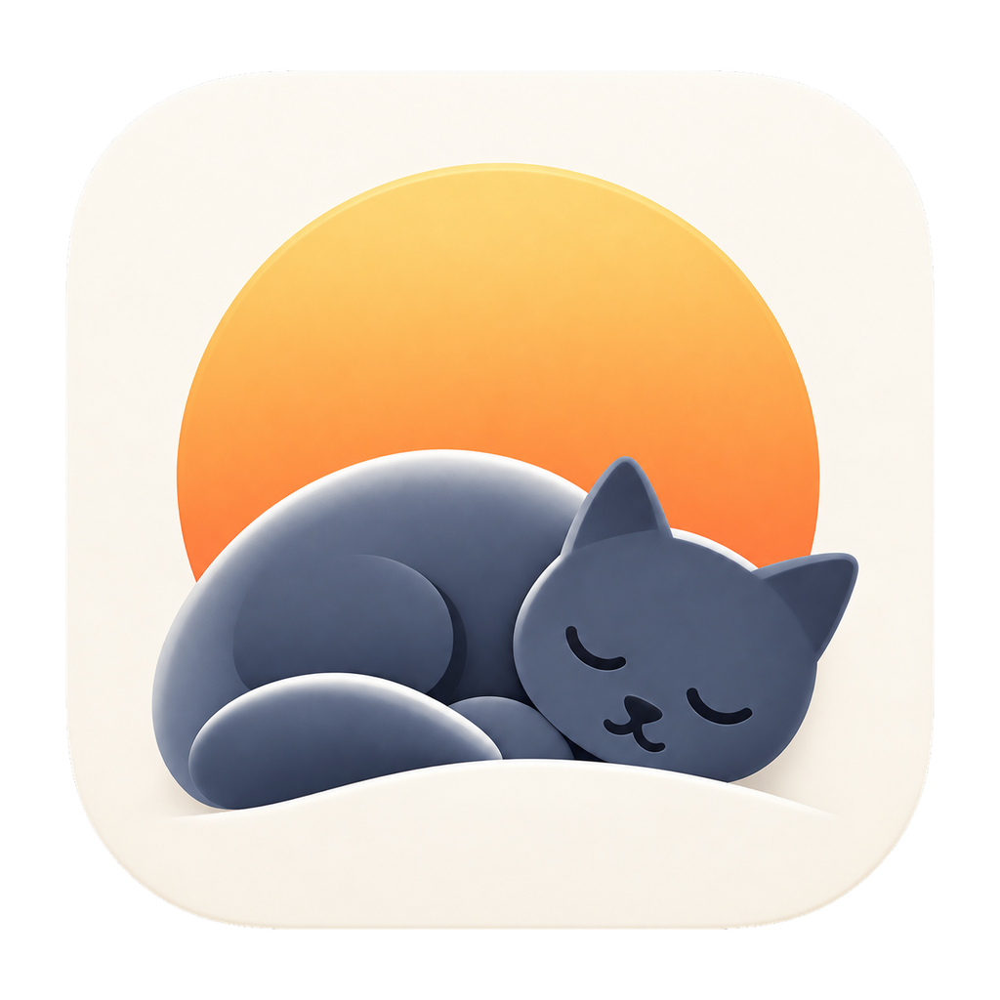
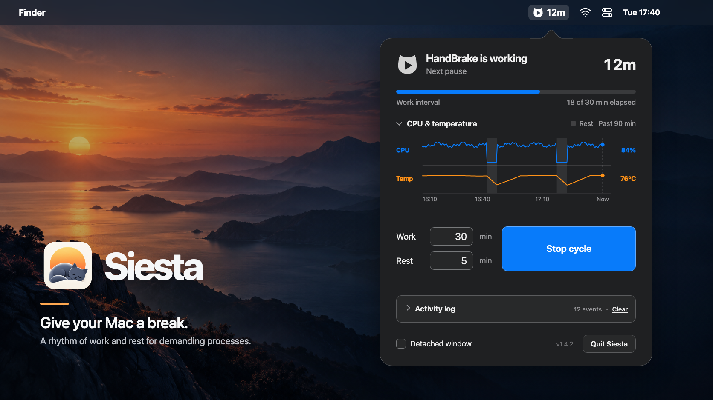
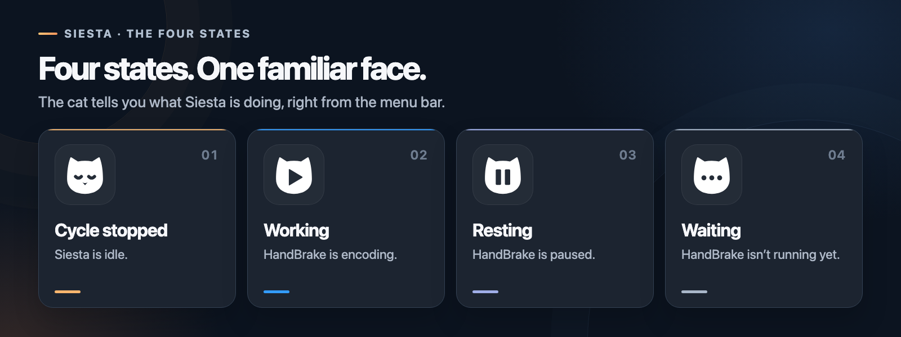
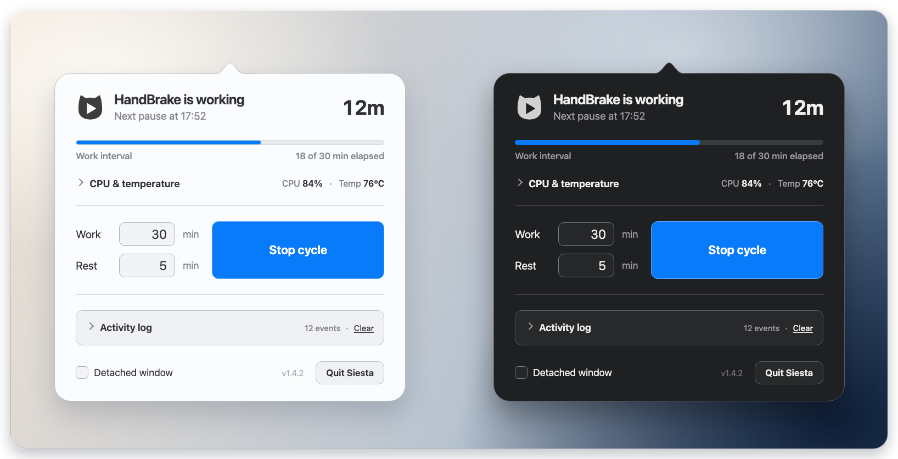
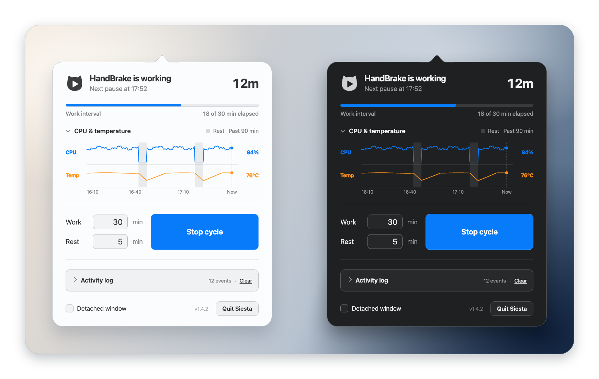
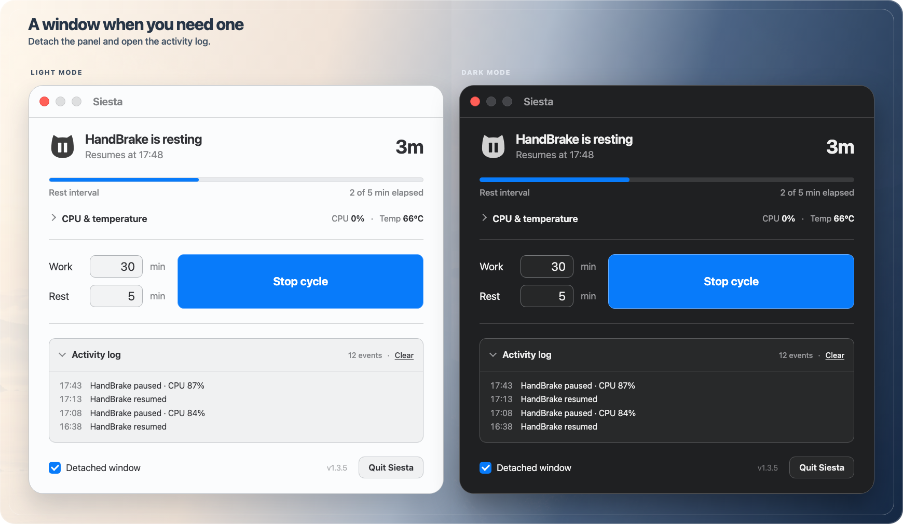
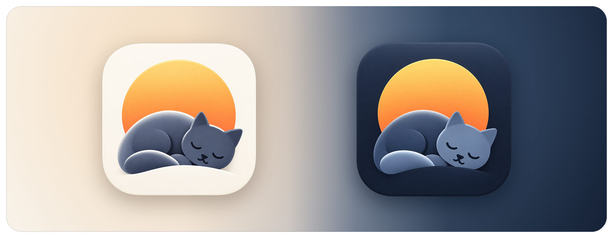

# Siesta

<picture>
  <source media="(prefers-color-scheme: dark)" srcset="Resources/icon/Siesta-light-1024.png">
  <source media="(prefers-color-scheme: light)" srcset="Resources/icon/Siesta-dark-1024.png">
  
</picture>

**Give your Mac a break.** Siesta is a tiny macOS menu bar utility that gives demanding, long-running processes a rhythm of work and rest. Today it gives HandBrake periodic rests, so a laptop does not run flat out for hours on a long job or a queue of files.

Siesta counts the minutes the encoder has **actually** been working, then pauses it for a rest period and resumes it afterwards. The encoder simply continues from where it was: Siesta never restarts the job or touches the output file.

**HandBrake** is the first supported app. The code is structured so other encoders (Tdarr, Topaz Video AI, plain ffmpeg…) can be added as profiles.

<picture>
  <source media="(prefers-color-scheme: dark)" srcset="Resources/siesta-hero-dark.png">
  <source media="(prefers-color-scheme: light)" srcset="Resources/siesta-hero-light.png">
  
</picture>

## How it works

- Every second Siesta looks at the processes that belong to HandBrake and adds up their CPU usage. HandBrake does the real encoding in a separate XPC worker: that is what Siesta pauses, so the HandBrake window stays responsive. If no worker can be identified, Siesta falls back to pausing the HandBrake processes it found.
- **Work minutes** only advance while HandBrake is encoding (CPU above a threshold, 50 % by default). If the queue is finished or HandBrake is closed, Siesta waits and says so.
- When the work minutes are up, the worker receives `SIGSTOP` for the configured **rest minutes**, then `SIGCONT`. CPU usage drops to zero during the rest.
- If HandBrake stays idle for at least the rest duration, the work counter resets: it already had its rest.
- Stopping or quitting Siesta always resumes a frozen worker first.

### Four states. One familiar face.

**The cat tells you what Siesta is doing, right from the menu bar.** It changes to show whether the cycle is stopped, HandBrake is encoding, taking a scheduled rest, or Siesta is waiting for work. During work and rest, the number beside it shows the minutes until the next change.

<picture>
  <source media="(prefers-color-scheme: dark)" srcset="Resources/siesta-states-dark.png">
  <source media="(prefers-color-scheme: light)" srcset="Resources/siesta-states-light.png">
  
</picture>

### The panel

**Everything Siesta knows, one click away.** Clicking the menu bar icon opens a popover with the current state and a countdown to the next change, a thin progress line for the running interval, the Work and Rest minutes, the Start/Stop cycle button, a collapsible activity log and a Quit button. "Next pause at" and "Resumes at" show exact times, because pauses start on a whole minute and rests last exactly the minutes you set.

You can change Work and Rest while the cycle runs: the new value applies as soon as you confirm it with Return, Tab or a click elsewhere, and the change appears in the activity log. In the two fields, the ↑ and ↓ keys step the value by one minute, by ten with Shift. **Stop cycle** stops Siesta's cycle, never the encoder.

<a href="Resources/siesta-interface-compact.png">
  
</a>

### See the cycle unfold

**Open the graph to follow CPU load, temperature and scheduled rests.** Expand **CPU & temperature** to see the recent history. The blue line is the encoder's CPU usage as a share of the whole Mac, from 0% to 100%; the orange line is the hottest CPU die. The shaded bands mark scheduled rests: CPU usage falls while the worker is paused, and the temperature line shows how the Mac responds.

The chart starts with a five-minute view, grows with the session, and then keeps a rolling six-hour history. Hovering over the plot shows the readings and the time of that moment. Pinch on the trackpad or scroll over the plot to zoom in on the recent part, down to 30 seconds and never beyond the recorded history; click **Reset** to return to the automatic view.

Collapse the chart with the chevron next to its title and the header keeps showing the current CPU and temperature readings, as in the compact view above, just the current readings. Siesta remembers whether you left the chart and the log open or closed.

<a href="Resources/siesta-interface-expanded.png">
  
</a>

### A window when you need one

**Detach the panel and open the activity log.** Turn on **Detached window** to keep Siesta open as a regular window that floats above your other apps, handy when you want to keep an eye on a long queue without reopening the popover. It holds exactly the same panel, with a little more room for the activity log. Here the chart is collapsed and **Activity log** is expanded, showing recent pauses and resumes. Uncheck Detached window to return to the menu bar popover.

<a href="Resources/siesta-interface-detached.png">
  
</a>

### A little about the name

Siesta takes its name from the afternoon nap. The cat curled up beneath a warm sun reflects the same idea: even a Mac running a long encode deserves a little rest along the way.



## Download

Grab `Siesta-<version>.zip` from the [Releases](https://github.com/Interstellar0verdrive/Siesta/releases) page, unzip it and move `Siesta.app` to your Applications folder. The app is universal (Apple Silicon and Intel) and needs macOS 13 or later.

Siesta is signed ad hoc and is not notarized, so macOS blocks the first launch with a "Siesta was not opened" dialog. Click **Done**, then go to System Settings → Privacy & Security, find the message about Siesta and click **Open Anyway**. This is only needed once. If you prefer the Terminal, removing the quarantine flag has the same effect:

```bash
xattr -d com.apple.quarantine /Applications/Siesta.app
```

## Updates

The current version is shown in small print next to the Quit button. While Siesta is running it asks GitHub for the latest release at launch and then every six hours; nothing runs while the app is closed.

When a newer release exists the version turns into an **Update to x.y.z** link. Clicking it downloads the release archive, verifies its SHA-256 checksum against the one published with the release, replaces the app in place (the old copy goes to the Trash) and relaunches. Because the new bundle is written by Siesta itself it carries no quarantine flag, so macOS does not ask for approval again: only the very first installation needs it. If the app lives in a folder Siesta cannot write to, or anything goes wrong, the link simply opens the release page instead.

## Building

Only the Xcode Command Line Tools are needed:

```bash
./build.sh
```

The app is produced at `build/Siesta.app` as a universal binary; `./build.sh --zip` also packages it for a release.

Launching the binary with `--start` starts the cycle immediately with the last saved values.

## Preferences

Stored in the `io.github.interstellar0verdrive.siesta` defaults domain: `work`, `rest` (minutes), `window` (detached window), `threshold` (CPU percentage considered "encoding", default 50, not exposed in the UI).

## Is pausing safe for the files?

A pause is `SIGSTOP`, which only suspends scheduling of the worker; `SIGCONT` lets it continue exactly where it was, and pending disk writes complete on resume. Siesta never reads, deletes or rewrites the output file. It cannot protect against unrelated failures such as a crash, a power loss or HandBrake being force-quit during an encode, exactly as without Siesta.

Siesta resumes a frozen worker when you stop the cycle, quit, or when it receives a termination signal (kill, logout). A `kill -9` cannot be intercepted and may leave the worker frozen; the file is still fine, and the next launch of Siesta detects and resumes it. You can also resume HandBrake's worker by hand:

```bash
kill -CONT $(pgrep -x HandBrakeXPCService)
```

## A note from the author

Siesta started as a tool I built for myself, and it still is one. I am sharing it in case it is useful to someone else, with a few honest caveats:

- **No warranty.** Siesta pauses and resumes other programs and keeps your Mac running long jobs. I have taken care to make that safe, but you use it at your own risk: I cannot take responsibility for lost encodes, overheated hardware or anything else that may go wrong.
- **No promise of maintenance.** This is a hobby project, not a commercial product. I will keep improving it as long as I use it, but there is no schedule and no guarantee of support. Suggestions, bug reports and code contributions are very welcome, with the same spirit in mind.
- **How it was made.** Part of the code was written with the help of AI tools. The design, the decisions, the review and the testing on several Macs are mine.
- **macOS only.** Siesta relies on macOS features and there are no plans for a Windows or Linux version.

Thank you for trying it. I hope it gives your Mac, and you, a well-deserved rest.

## License

MIT, see [LICENSE](LICENSE).
